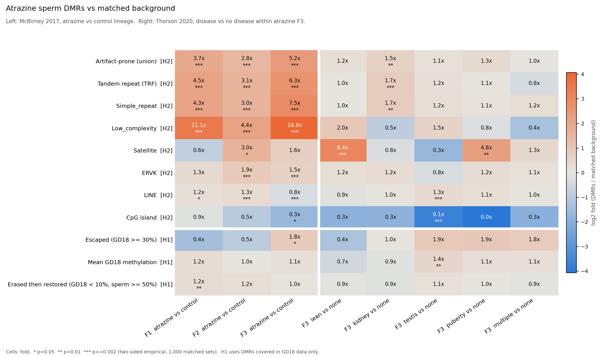

# Do transgenerational sperm DMRs sit in regions that escape germline reprogramming?

**Week 12, Data Reuse project.** Rat, public data only: published DMR tables from two atrazine transgenerational studies, re-tested against an independent germ cell methylome and genome annotations.

## Summary

Transgenerational epigenetic inheritance needs an epimutation to survive germline DNA methylation erasure. If published sperm DMRs reflect real inheritance, they might be expected to sit in regions that stay methylated when the germline methylome is at its lowest point (gestational day 18, GD18, in rat gonocytes). We tested this, and a competing explanation: that DMRs sit in repeat regions where MeDIP coverage is sensitive to copy number and mappability.

**Main results**
1. **No evidence that DMRs sit in regions that escape reprogramming.** In every DMR set, GD18 methylation at DMRs matched the background (median about 3%). Only the F3 set showed a marginal excess at the 30% threshold (15 of 387 covered DMRs; 1.8x; p = 0.036, not robust to multiple testing).
2. **Strong enrichment in tandem, simple and low-complexity repeats, but only in the between-lineage comparisons.** McBirney 2017 atrazine vs control DMRs: 3.7x (F1), 2.8x (F2), 5.2x (F3). 72% of F3 DMRs have at least 10% of their bp in these repeats, against 14% for matched background. With a 50% overlap threshold the enrichment rises to 11.9x.
3. **The broad repeat enrichment is absent in within-lineage comparisons.** Thorson 2020 disease vs no-disease DMRs from the same atrazine F3 lineage: 1.0 to 1.3x for four of five diseases, 1.5x for kidney. The exception is satellite repeats, enriched in two disease sets (lean 8.4x, puberty 4.8x); satellites cover about 0.3% of rn6, so this involves few DMRs.

**Interpretation.** The repeat enrichment tracks the comparison design (separately bred lineages), not exposure generation or disease. This is consistent with genetic divergence between lineages (for example tandem repeat length polymorphism) being read as differential MeDIP coverage. It does not prove it: the two studies also differ in MEDIPS window size (100 vs 1000 bp) and DMR p-value thresholds. See Limitations.



## Hypotheses

| | Hypothesis | Prediction |
|---|---|---|
| **H1** | Escape (biological persistence) | DMRs overlap regions that stay methylated in GD18 gonocytes more than matched background |
| **H2** | Technical or genomic artifact | DMRs are enriched in tandem, simple and low-complexity repeats, independent of GD18 status |
| **H0** | No association | DMR distribution matches matched background for both |

## Data

| Role | Study | What was used | Source |
|---|---|---|---|
| DMRs, between lineages | McBirney et al. 2017, *PLoS ONE* | Sperm DMRs, atrazine vs control lineage: F1 (519, p<1e-6), F2 (431, p<1e-5), F3 (958, p<1e-9). MeDIP-seq, 100 bp windows | Supplementary Tables S3 to S5 (PDF), extracted to `data/dmrs/` |
| DMRs, within lineage | Thorson et al. 2020, *PLoS ONE* | F3 atrazine lineage sperm DMRs, disease vs no disease: lean 301, kidney 261, testis 693, puberty 322, multiple 336 (p<1e-4). MeDIP-seq, 1000 bp windows | Supplementary Tables S2 to S6 (PDF), extracted to `data/dmrs/` |
| Escape reference | El Omri-Charai et al. 2023, *Development* | Methyl-seq capture (Bismark `.cov`), GD18 gonocytes (GSM6801700 to GSM6801703) and spermatozoa (GSM6801728 to GSM6801731), 4 replicates each | GEO GSE220440 |
| Annotation | UCSC rn6 | RepeatMasker, simpleRepeat (TRF), gap, cpgIslandExt. `genomicSuperDups` does not exist for rn6 | UCSC |

All coordinates are rn6 (Rnor_6.0). DMR tables are redistributed under the CC-BY 4.0 license of PLoS ONE; cite the original papers.

## Input validation

Each input was checked before analysis (scripts in `scripts/`):

- **GD18 and sperm methylation calls are on rn6** (`01_check_assembly.py`): 100% of positions in a GD18 file are cytosines in rn6; 89.5% are CpGs and the rest are CHG/CHH calls with median depth 2, removed by the coverage filter. Capture is strand-asymmetric (median depth 52 on the minus strand vs 7 on the plus strand); strands are pooled per CpG.
- **McBirney DMR coordinates are on rn6** (`03_check_dmr_assembly.py`): recounting CpGs in rn6 over each F3 DMR reproduces the paper's CpG number exactly for 99.4% of DMRs and within 1 CpG for 100% (r = 1.000). Thorson 2020 states rn6.
- **PDF extraction is complete** (`scripts/extract_pdf_tables/`): every table matches the DMR count reported in the papers. Repaired PDF defects: DMR name glued to the chromosome column (22 rows, McBirney F3), CpG density glued to gene names (352 rows, Thorson S4, including gene names starting with a digit such as 7SK), stop coordinates printed in scientific notation (2 rows, recomputed as start + length - 1). Checks: name equals chr:start, no duplicates, CpG density equals CpG number / length, starts fall on the MEDIPS window grid (1-based).

## Method

For each DMR set (`scripts/dmr_escape.py`):

1. **Matched background.** For every DMR, 1,000 random regions on the same chromosome, with the same length, the same CpG density bin (quintiles of the DMR set, CpG counted from rn6) and less than 5% N or assembly gap.
2. **H2, genome-wide.** A DMR "hits" an annotation if at least 10% of its bp overlap it (robustness: 50%). Annotations: RepeatMasker classes and ERV/L1 families, TRF tandem repeats, CpG islands, and an artifact-prone union (TRF, simple repeat, low complexity, satellite).
3. **H1, inside the covered universe.** Only DMRs with at least 3 CpGs covered in GD18 data (pooled replicates, at least 5 reads per CpG) are tested, and their background is drawn inside the covered universe (anchored on covered CpGs, also at least 3 covered CpGs), so capture design does not drive the result. Escaped = mean GD18 methylation at or above 30, 50 or 70%. Erased then restored = GD18 below 10% and sperm at or above 50%.
4. **Statistics.** Fold = observed / mean of the null; empirical p = (1 + number of null sets at least as extreme) / (n_perm + 1), two-sided. With 1,000 permutations the smallest p is about 0.002 two-sided. Permutations use a fixed seed (`--seed 1`), so reruns on the same inputs give identical numbers.

The pipeline was checked on synthetic data with planted signal (`tests/make_test_data.py`): planted enrichments (about 6x and 5x) were recovered and unplanted classes stayed near 1x.

## Results

| Comparison | Set | DMRs | % covered in GD18 | Artifact-prone: DMRs vs null | Fold | p | TRF fold | Escaped (GD18 >= 30%): DMRs vs null | p |
|---|---|---|---|---|---|---|---|---|---|
| Between lineages | McBirney F1 | 519 | 32.0 | 0.536 vs 0.144 | **3.71** | 0.002 | 4.45 | 0.006 vs 0.016 | 0.50 |
| | McBirney F2 | 431 | 21.8 | 0.406 vs 0.147 | **2.76** | 0.002 | 3.07 | 0.011 vs 0.020 | 0.88 |
| | McBirney F3 | 958 | 40.4 | 0.716 vs 0.138 | **5.18** | 0.002 | 6.34 | 0.039 vs 0.021 | 0.036 |
| Within lineage | Thorson lean | 301 | 31.6 | 0.163 vs 0.141 | 1.16 | 0.31 | 1.02 | 0.011 vs 0.025 | 0.62 |
| | Thorson kidney | 261 | 42.9 | 0.222 vs 0.144 | 1.55 | 0.004 | 1.70 | 0.027 vs 0.026 | 1.00 |
| | Thorson testis | 693 | 32.8 | 0.156 vs 0.141 | 1.10 | 0.30 | 1.17 | 0.040 vs 0.021 | 0.10 |
| | Thorson puberty | 322 | 31.4 | 0.183 vs 0.143 | 1.28 | 0.06 | 1.06 | 0.050 vs 0.026 | 0.24 |
| | Thorson multiple | 336 | 30.9 | 0.143 vs 0.144 | 0.99 | 1.00 | 0.77 | 0.048 vs 0.027 | 0.27 |

**McBirney F3 in detail** (`results/McBirney_F3/`)
- H2: simple repeats 43% vs 5.6% (7.5x), low complexity 8.6% vs 0.5% (16.8x), TRF 63% vs 9.9% (6.3x), ERVK 1.5x. LINE/L1 (0.8x), ERVL-MaLR (0.7x) and CpG islands (0.3x) are depleted.
- The enrichment is not driven by long DMRs (75% artifact-prone at 1 kb or less, 62% above 4 kb) or by one chromosome (59% on chr20 to 90% on chr19).
- H1: mean GD18 methylation 5.8% vs 5.1%; escaped at 30% / 50% / 70%: 15 / 5 / 1 of 387 covered DMRs. Erased then restored: 53.7% vs 52.3%. The 15 DMRs above 30% are not distinctive (8 artifact-prone, 1 ERVK, none in CpG islands).

**Across all sets** (`results/comparison_heatmap.png`)
- Tandem, simple and low-complexity repeats: enriched in all three McBirney generations, near 1x in Thorson (kidney 1.5 to 1.7x).
- Satellites: enriched in Thorson lean (8.4x, p <= 0.002) and puberty (4.8x, p < 0.01), not consistently in McBirney. Satellites are copy-number variable, so this is also artifact-prone signal, but in few DMRs.
- CpG islands are depleted in every set (0.1 to 0.9x), despite matching on CpG density.
- H1: no set shows enrichment of escaped regions beyond the marginal F3 result; Thorson testis has slightly higher mean GD18 methylation (1.4x, p < 0.01) without more DMRs above 30%.

**Robustness** (`robustness/McBirney_F3_overlap50/`, figure `robustness/robustness_F3_10vs50.png`): requiring at least 50% of DMR bp in the repeat, artifact-prone 107 DMRs, 11.2% vs 0.9% (11.9x); TRF 80 DMRs (11.4x); simple repeats 44 DMRs (35.8x); low complexity 5 DMRs (37.6x, few DMRs). Enrichment grows with the overlap requirement, while LINE drops to 0.5x and no DMR is mostly SINE or CpG island.

## Limitations

- **Window size and thresholds differ between studies.** McBirney used 100 bp MEDIPS windows and p<1e-6 to 1e-9; Thorson used 1000 bp windows and p<1e-4. Finer windows could detect coverage differences concentrated in short repeats. The between vs within lineage contrast is therefore confounded with method. The cleanest test would re-call DMRs from the raw MeDIP reads (GEO) with one window size for both designs.
- **No direct test of genetic divergence.** Without input or whole-genome sequencing of the lineages, copy number or repeat length differences cannot be measured, only inferred from where DMRs fall.
- **H1 universe.** The methyl-seq capture covers 22 to 43% of DMRs depending on the set, biased to genic regions. Anchoring background draws on covered CpGs slightly over-represents CpG-dense captured regions; CpG density matching limits this.
- **GD18 is a population average.** A gonocyte subpopulation that escapes erasure would be diluted.
- **Pooled MeDIP samples** in the original studies hide individual variability.
- **No segmental duplication track** exists for rn6 at UCSC; the artifact-prone union uses tandem, simple, low-complexity and satellite repeats only.
- **Multiple testing.** Many features are tested per set; only results far below p = 0.05 and consistent across sets are interpreted.

## Reproduce

Requirements: Python 3.9+ with numpy, pandas, matplotlib, openpyxl (pdfplumber only to re-extract the PDF tables). No bedtools.

```bash
# 1. public inputs (about 1.1 GB)
bash scripts/00_download.sh data
#    then download GD18 (GSM6801700-03) and sperm (GSM6801728-31) .cov.gz into data/methyl/gd18 and data/methyl/sperm
#    (sample links are printed by the script)

# 2. input checks
python3 scripts/01_check_assembly.py data/genome/rn6.fa.gz data/methyl/gd18/GSM6801701*.cov.gz
python3 scripts/03_check_dmr_assembly.py data/dmrs/McBirney2017_F3_DMRs.tsv data/genome/rn6.fa.gz

# 3. pipeline test on synthetic data (1 minute)
python3 tests/make_test_data.py /tmp/td
python3 scripts/dmr_escape.py --genome /tmp/td/genome.fa.gz --dmrs /tmp/td/dmrs.xlsx --rmsk /tmp/td/rmsk.txt.gz \
  --gap /tmp/td/gap.txt.gz --segdup /tmp/td/genomicSuperDups.txt.gz --gd18 /tmp/td/gd18/*.cov.gz \
  --sperm /tmp/td/sperm/*.cov.gz --out /tmp/res

# 4. all DMR sets + robustness + comparison figure (SLURM; about 30 min)
sbatch scripts/run_easley.sh all
```

The first run indexes rn6 (CpG positions, N runs) into `data/genome/rn6.fa.gz.idx.npz`; later runs reuse it.

## Repository layout

```
scripts/
  00_download.sh            rn6 genome, UCSC tracks, GSE220440 sample list
  01_check_assembly.py      are methylation calls on rn6?
  02_check_dmrs.py          inspect a DMR table (header, coordinates, window grid)
  03_check_dmr_assembly.py  are DMR coordinates on rn6? (CpG recount vs paper)
  dmr_escape.py             H1 / H2 tests with matched permutations, per DMR set
  04_compare.py             all sets: comparison_table.tsv and comparison_heatmap.png
  05_robustness_figure.py   slide figure: F3 at 10% vs 50% overlap, log scale
  run_easley.sh             SLURM job for everything
  extract_pdf_tables/       PDF supplementary tables -> data/dmrs/*.tsv
tests/make_test_data.py     synthetic data with planted signal
data/dmrs/                  extracted DMR tables (rn6, 1-based)
results/<set>/              enrichment.tsv, dmrs_annotated.tsv, report.json, figures
results/comparison_*        cross-set table and heatmap
robustness/                 McBirney F3 with 50% overlap requirement
```

Per-set outputs: `enrichment.tsv` (observed, null mean and 95% interval, fold, empirical p for every test), `dmrs_annotated.tsv` (each DMR with CpG density, annotation overlaps, GD18 and sperm methylation), `report.json` (coverage and matching bins), `fig1_enrichment.png`, `fig2_gd18_methylation.png`.

## Next steps

- Re-call DMRs from the raw MeDIP reads of both studies with identical windows and thresholds, to separate design from method.
- Check whether repeat-overlapping DMRs show coverage differences in input or whole-genome data of the lineages, if available.
- Thorson 2020 also reports differential histone retention regions (S7 to S12): histone retention is a proposed route for escaping protamine replacement and could be tested with the same framework.
- Cattle: preimplantation methylomes exist (Jiang et al. 2018; Duan et al. 2019) but no PGC methylome, so only the embryonic wave can be tested.

## References

1. McBirney M, King SE, Pappalardo M, et al., Skinner MK (2017). Atrazine induced epigenetic transgenerational inheritance of disease, lean phenotype and sperm epimutation pathology biomarkers. *PLoS ONE* 12(9): e0184306. https://doi.org/10.1371/journal.pone.0184306
2. Thorson JLM, Beck D, Ben Maamar M, Nilsson EE, McBirney M, Skinner MK (2020). Epigenome-wide association study for atrazine induced transgenerational DNA methylation and histone retention sperm epigenetic biomarkers for disease. *PLoS ONE* 15(12): e0239380. https://doi.org/10.1371/journal.pone.0239380
3. El Omri-Charai R, Gilbert I, Prunier J, Desmarais R, Ghinet MG, Robert C, Boissonneault G, Delbes G (2023). DNA methylation dynamic in male rat germ cells during gametogenesis. *Development* 150(13): dev201606. https://doi.org/10.1242/dev.201606 (GEO GSE220440)
4. Ben Maamar M, Beck D, Nilsson E, McCarrey JR, Skinner MK (2022). Developmental alterations in DNA methylation during gametogenesis from primordial germ cells to sperm. *iScience* 25(2): 103786. https://doi.org/10.1016/j.isci.2022.103786
5. Jiang Z, Lin J, Dong H, et al., Tian XC (2018). DNA methylomes of bovine gametes and in vivo produced preimplantation embryos. *Biology of Reproduction* 99(5): 949-959. https://doi.org/10.1093/biolre/ioy138
6. Duan JE, Jiang ZC, Alqahtani F, et al. (2019). Methylome dynamics of bovine gametes and in vivo early embryos. *Frontiers in Genetics* 10: 512. https://doi.org/10.3389/fgene.2019.00512
